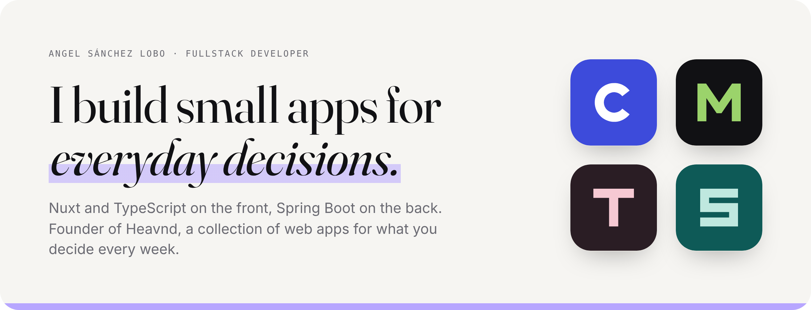
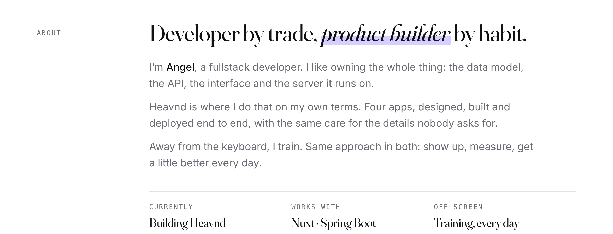
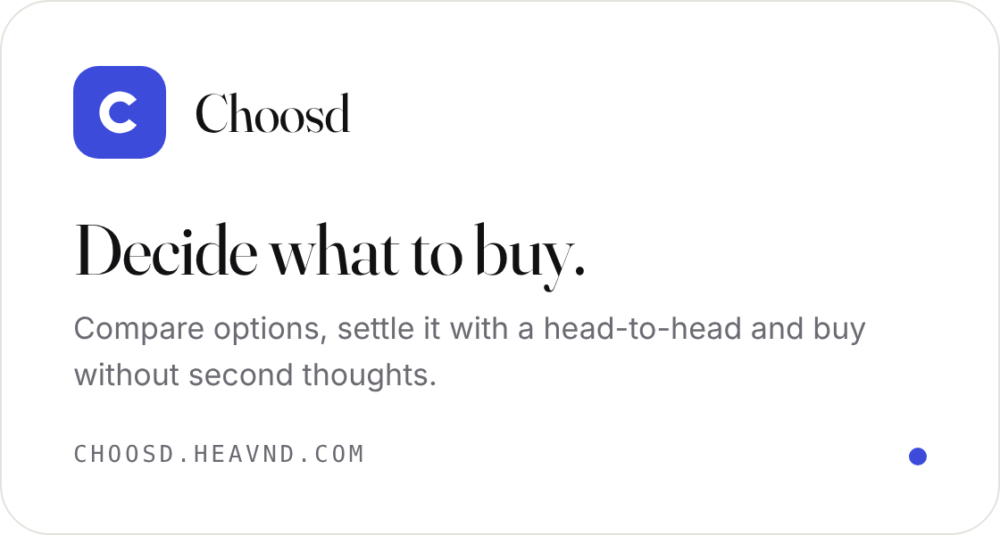
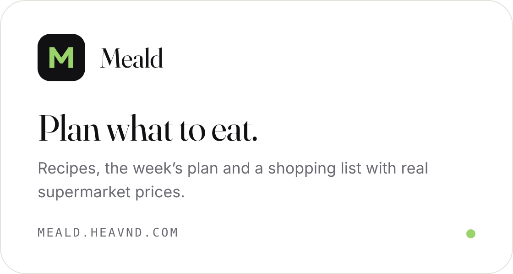
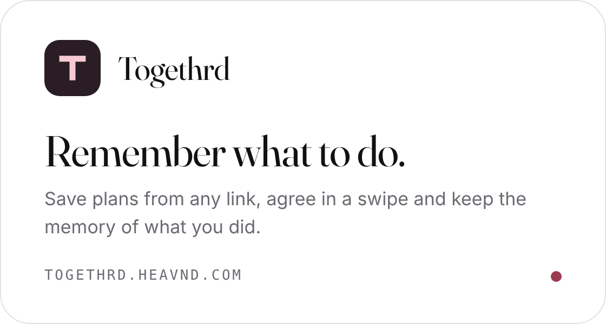
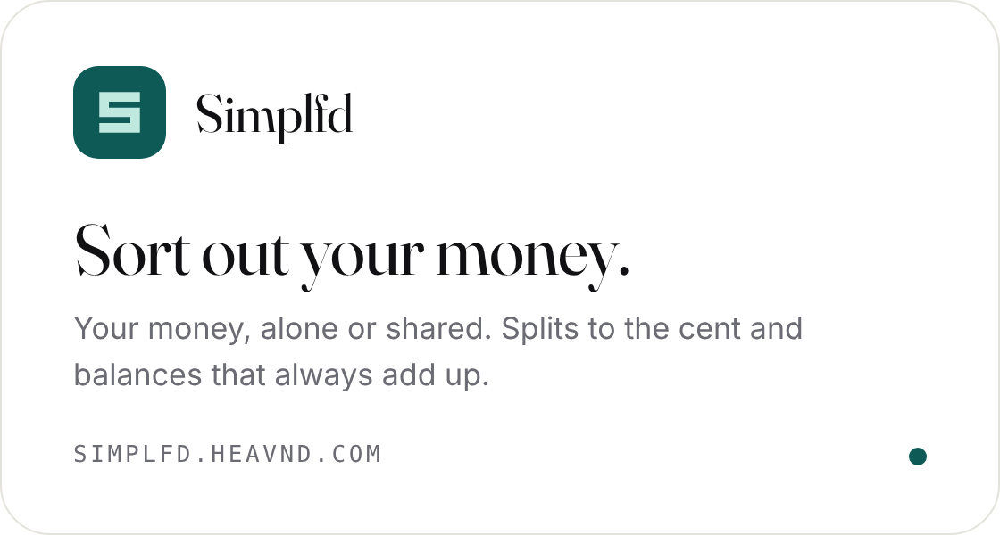
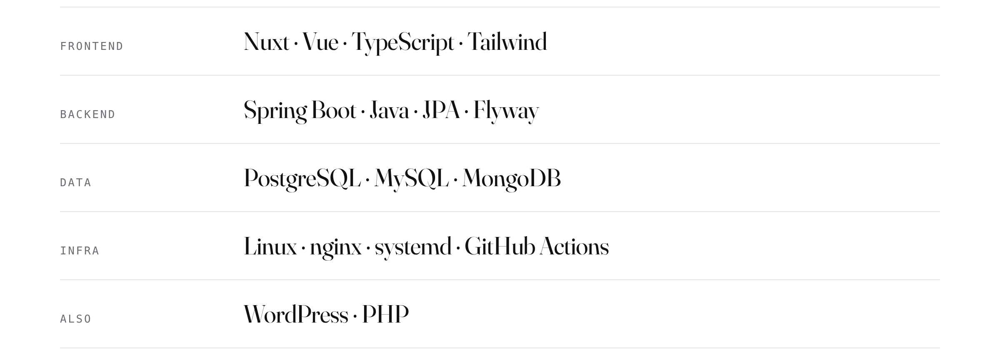

  <picture><source media="(prefers-color-scheme: dark)" srcset="assets/header-dark.png"></picture>

 

<picture><source media="(prefers-color-scheme: dark)" srcset="assets/about-dark.png"></picture>

 

<a href="https://heavnd.com"><picture><source media="(prefers-color-scheme: dark)" srcset="assets/heavnd-dark.png"></picture></a>

  <a href="https://choosd.heavnd.com"><picture><source media="(prefers-color-scheme: dark)" srcset="assets/choosd-dark.png"></picture></a>
  <a href="https://meald.heavnd.com"><picture><source media="(prefers-color-scheme: dark)" srcset="assets/meald-dark.png"></picture></a>

  <a href="https://togethrd.heavnd.com"><picture><source media="(prefers-color-scheme: dark)" srcset="assets/togethrd-dark.png"></picture></a>
  <a href="https://simplfd.heavnd.com"><picture><source media="(prefers-color-scheme: dark)" srcset="assets/simplfd-dark.png"></picture></a>

 

<picture><source media="(prefers-color-scheme: dark)" srcset="assets/stack-dark.png"></picture>

 

  <a href="https://heavnd.com">heavnd.com</a>
  &nbsp;·&nbsp;
  <a href="https://linkedin.com/in/angelsanchezlobo">LinkedIn</a>
  &nbsp;·&nbsp;
  <a href="mailto:angelsanlobo@gmail.com">angelsanlobo@gmail.com</a>

